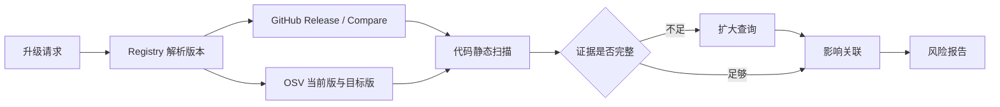

# Dependency Intelligence Agent

一个以证据为基础的依赖升级影响分析项目。输入依赖名称、当前版本、目标版本和项目目录，系统会查询真实的 Registry、GitHub 和 OSV 数据，扫描本地代码，并输出受影响文件、风险结论、修改建议和验证步骤。

> 当前重点是“按需升级分析”闭环，不会自动修改或升级用户代码。定时 Release Radar 可以在此基础上继续扩展。

## 能力

- 支持 PyPI 与 npm 包版本解析，`latest` 会解析为最新稳定版。
- 查询 GitHub Releases；缺少匹配 Release 时回退到 Git Compare。
- 同时查询当前版本和目标版本的 OSV 漏洞，判断升级是否真正修复漏洞。
- 使用 Python AST 追踪 `import`、别名、`from ... import ...`；扫描 JS/TS 的 ES Module 和 CommonJS 引用。
- 将发布说明中明确出现的变更符号与实际代码位置关联，避免凭模型记忆下结论。
- 使用 LangGraph 编排解析、证据采集、代码扫描、验证、回退查询和报告生成。
- 提供 CLI、FastAPI 和 MCP stdio Server 三种入口。
- 默认无需大模型；可选用 OpenAI 生成受证据约束的摘要。

## 工作流



## 项目结构

```text
app/
├── api.py            # FastAPI 接口
├── cli.py            # 命令行入口
├── code_scanner.py   # Python AST 与 JS/TS 静态扫描
├── evidence.py       # PyPI/npm、GitHub、OSV 客户端
├── graph.py          # LangGraph 主流程与回退分支
├── llm.py            # 可选的证据约束摘要
├── mcp_server.py     # MCP 工具入口
├── models.py         # 请求、证据、报告模型
├── reporting.py      # 影响关联与确定性报告
└── versioning.py     # 版本比较
tests/                # 单元及工作流测试
examples/             # 可扫描的示例项目
```

## 安装

推荐 Python 3.11 或 3.12：

```bash
cd dependency_intelligence_agent
python3.12 -m venv .venv
source .venv/bin/activate
pip install -e '.[dev,mcp]'
```

如果本机只有其他受支持的 Python 3.11+，把 `python3.12` 换成对应命令即可。

## CLI 演示

分析示例项目从 Pydantic 1.10.13 升级到 2.0.0：

```bash
dependency-intelligence \
  pydantic 1.10.13 2.0.0 \
  ./examples/sample_python_project \
  --github-repo pydantic/pydantic
```

JSON 输出：

```bash
dependency-intelligence pydantic 1.10.13 latest ./examples/sample_python_project --format json
```

无需 `OPENAI_API_KEY`。只有显式增加 `--use-llm` 时才会调用 OpenAI。

## FastAPI

```bash
uvicorn app.api:app --reload
```

打开 <http://127.0.0.1:8000/docs>，或调用：

```bash
curl -X POST http://127.0.0.1:8000/v1/upgrades/analyze \
  -H 'Content-Type: application/json' \
  -d '{
    "package": "pydantic",
    "current_version": "1.10.13",
    "target_version": "2.0.0",
    "project_path": "/workspace/project",
    "ecosystem": "PyPI"
  }'
```

生产部署时务必设置 `ALLOWED_PROJECT_ROOT=/workspace`，避免 API 扫描允许目录之外的路径。可设置 `GITHUB_TOKEN` 提高 GitHub API 限额。

## MCP Server

```bash
dependency-intelligence-mcp
```

它通过 stdio 暴露 `analyze_dependency_upgrade` 工具。MCP Client 启动配置示例：

```json
{
  "mcpServers": {
    "dependency-intelligence": {
      "command": "/absolute/path/.venv/bin/dependency-intelligence-mcp"
    }
  }
}
```

## 测试

```bash
pytest -q
```

测试使用 Fake Gateway，不依赖 GitHub、PyPI 或 OSV 网络状态；真实端到端演示才访问公网。

## 报告可信度边界

- “高置信度影响”只在发布证据明确命名符号且项目确实使用该符号时生成。
- GitHub 项目可能没有 Release，或 Release Note 未覆盖所有变更；报告会将这些情况列在 `evidence_gaps`。
- JavaScript 扫描是轻量语法扫描，不代替完整 TypeScript Language Service。
- 工具不会执行目标项目代码，也不会自动写入项目文件。
- OSV 无记录不等于依赖绝对安全。

## 后续扩展：Release Radar

当前的 Registry、GitHub、OSV、报告和通知数据结构都可以复用。下一阶段可增加 manifest 批量解析与 APScheduler：定时读取 `requirements.txt` / `package.json`，只把安全修复、弃用、破坏性变更和大版本升级送入本项目的深度分析流程。

